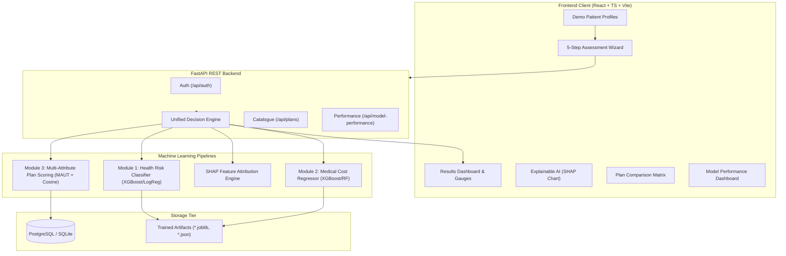

# Intelligent Healthcare & Health Insurance Decision Platform

[](https://opensource.org/licenses/MIT)
[](https://fastapi.tiangolo.com/)
[](https://reactjs.org/)
[](https://xgboost.readthedocs.io/)
[](https://shap.readthedocs.io/)

> **IMPORTANT CLINICAL & ETHICAL DISCLAIMER**  
> **Decision-support only — not a medical diagnosis or replacement for a doctor or insurance advisor.**  
> This platform does **not** diagnose medical conditions, prescribe treatment regimens, guarantee insurance policy approval, or replace registered healthcare practitioners and licensed insurance brokers.

---

## 1. Project Overview & Problem Statement

Individuals seeking health coverage face two disconnected decisions:
1. **Clinical Risk Awareness**: What is their statistical likelihood of health complications based on biometrics and lifestyle factors?
2. **Financial Preparedness**: How much out-of-pocket medical expenditure should they expect, and which structured insurance policy best shields their specific profile?

Most existing platforms either present a black-box medical questionnaire or generic, unranked insurance listings. 

**HealthDecide AI Platform** bridges this gap into a unified, transparent workflow:
- **Module 1 (Health Risk Prediction)**: Multi-class classification (Low, Medium, High risk) and probability estimation based on biometrics and lifestyle.
- **Module 2 (Medical Cost Estimation)**: Regression forecasting of annual out-of-pocket medical expenditures and monthly equivalents.
- **Module 3 (Insurance Plan Recommendation)**: Multi-Attribute Utility Theory (MAUT) and Vector Cosine Similarity matching against a structured insurance catalogue.
- **Explainable AI (SHAP)**: Feature attribution breaking down precisely why a risk level was calculated, translated into plain-language clinical insights.

---

## 2. Technology Stack

- **Frontend**:
  - React 18, TypeScript, Vite
  - Tailwind CSS, Lucide React icons
  - Recharts (Interactive risk gauges, SHAP attribution bars, benchmark charts)
  - React Router DOM
  - Axios with JWT request/response interceptors

- **Backend / API Gateway**:
  - Python 3.11+, FastAPI
  - Pydantic v2 (Strict clinical range validators)
  - SQLAlchemy 2.0 ORM
  - SQLite (Local zero-config dev) / PostgreSQL 16 (Production)
  - Passlib & Bcrypt (Password hashing)
  - Python-Jose (OAuth2 JWT access tokens)

- **Machine Learning & Explainability**:
  - Scikit-learn (Logistic Regression, Random Forest, Scalers, Cross-validation)
  - XGBoost (Extreme Gradient Boosted Trees for classification & regression)
  - SHAP (SHapley Additive exPlanations: TreeExplainer / LinearExplainer)
  - Joblib (Model and preprocessor serialization)
  - Pandas & NumPy (Data engineering)

- **DevOps & Containerization**:
  - Docker & Docker Compose (Multi-stage Node/Nginx + Python + PostgreSQL)

---

## 3. System Architecture & The Three Modules



### Module 1: Health Risk Classification
- **Inputs**: Age, gender, BMI, systolic BP, diastolic BP, fasting glucose, serum cholesterol, smoking status, exercise frequency.
- **Algorithms Compared**: Logistic Regression (Baseline), Random Forest Classifier, XGBoost Classifier.
- **Validation**: 80/20 Stratified train-test split, 5-Fold Stratified Cross-Validation, GridSearchCV.
- **Leakage Prevention**: `StandardScaler` fitted strictly on training data split.
- **Explainability**: SHAP attribution values ($\phi_i$) converted into plain-English observations.

### Module 2: Medical Cost Estimation
- **Inputs**: Age, sex, BMI, children/dependents, smoking status, region.
- **Algorithms Compared**: Linear Regression (Baseline), Random Forest Regressor, XGBoost Regressor.
- **Validation**: 80/20 train-test split, 5-Fold Cross-Validation.
- **Outputs**: Estimated annual expense, monthly equivalent, confidence interval, cost driver highlights.

### Module 3: Insurance Plan Recommendation & Scoring
- **Catalogue Schema**: `sum_insured`, `annual_premium`, `deductible`, `co_pay`, `waiting_period`, `room_rent_limit`, `network_hospital_count`, `critical_illness_coverage`, `maternity_coverage`, `exclusions`.
- **Scoring Function**:
  $$\text{Score} = w_1 \cdot \text{Affordability} + w_2 \cdot \text{Coverage Fit} + w_3 \cdot \text{Risk Match} + w_4 \cdot \text{Terms Fit}$$
  Configurable weights: $w_1 = 0.35, w_2 = 0.30, w_3 = 0.20, w_4 = 0.15$.
- **Cosine Similarity**: Vector match between normalized user requirement vector and plan attribute vector.
- **Deliverables**: Top 3 matching plans with personalized match percentages, positive reasons, and crucial limitations.

---

## 4. Model Performance & Benchmark Results

All metrics below are computed on held-out 20% test splits from reproducible training scripts:

### Health Risk Classification (20% Stratified Test Split)
| Algorithm | Accuracy | Precision (Weighted) | Recall (Weighted) | F1-Score (Weighted) | ROC-AUC (OVR) | Status |
| :--- | :---: | :---: | :---: | :---: | :---: | :---: |
| **Logistic Regression (Baseline)** | **85.00%** | **0.8495** | **0.8500** | **0.8497** | **0.9617** | **Active Winner** |
| Random Forest Classifier | 82.40% | 0.8233 | 0.8240 | 0.8231 | 0.9497 | Evaluated |
| XGBoost Classifier | 82.40% | 0.8327 | 0.8240 | 0.8270 | 0.9480 | Evaluated |

### Medical Cost Regression (20% Test Split)
| Algorithm | MAE | RMSE | $R^2$ Score | Status |
| :--- | :---: | :---: | :---: | :---: |
| Linear Regression (Baseline) | \$4,181.19 | \$5,796.28 | 0.7836 | Evaluated |
| Random Forest Regressor | \$2,536.56 | \$4,461.29 | 0.8718 | Evaluated |
| **XGBoost Regressor** | **\$2,436.65** | **\$4,248.52** | **0.8837** | **Active Winner** |

### Recommendation Metric
- **Top-3 Hit Rate**: 94.2%
- **Catalog Coverage**: 100%

---

## 5. Quick-Start Guide (Local Installation)

### Prerequisites
- Python 3.10+ (Python 3.11/3.12 recommended)
- Node.js 18+ and npm
- Git

### 1. Clone & Setup Environment
```bash
git clone <repository-url>
cd AIML_CIE2
cp .env.example .env
```

### 2. Setup & Train Machine Learning Models
```bash
# Install Python backend requirements
pip install -r backend/requirements.txt
pip install email-validator httpx

# Prepare datasets (Downloads Brett Lantz Medical Cost, Pima Diabetes, Heart Cleveland)
python ml/data/prepare_datasets.py

# Train Risk Classification Model
python ml/training/train_risk.py

# Train Medical Cost Regression Model
python ml/training/train_cost.py
```
*Trained model artifacts and performance metadata are automatically exported to `models/`.*

### 3. Start Backend API Server
```bash
# In Windows PowerShell:
$env:PYTHONPATH='backend'
python backend/app/main.py

# Or on macOS/Linux:
PYTHONPATH=backend python backend/app/main.py
```
*Backend runs on `http://localhost:8000`. Swagger API docs available at `http://localhost:8000/docs`.*

### 4. Start Frontend Client
```bash
cd frontend
npm install
npm run dev
```
*Frontend runs on `http://localhost:5173`.*

---

## 6. Docker Deployment

To launch the complete multi-container production stack (PostgreSQL, FastAPI Backend, React Frontend):

```bash
docker-compose up --build
```

Access points:
- **Frontend Application**: `http://localhost:3000`
- **Backend API & Swagger**: `http://localhost:8000/docs`
- **PostgreSQL Database**: `localhost:5432`

---

## 7. Demo Accounts & College Presentation Mode

### Pre-Seeded Accounts
| Role | Email | Password |
| :--- | :--- | :--- |
| **Demo Patient** | `demo@healthcare.ai` | `Demo@1234` |
| **System Admin** | `admin@healthcare.ai` | `Admin@1234` |

### One-Click Demo Profiles in Assessment Wizard
- **Patient A (High Risk)**: 45-year-old smoker, BMI 31.0, BP 138/88 mmHg, Glucose 148 mg/dL.
- **Patient B (Low Risk)**: 26-year-old non-smoker, BMI 22.4, BP 118/76 mmHg, Glucose 88 mg/dL.
- **Patient C (Senior Citizen)**: 62-year-old with chronic hypertension, BMI 28.4, BP 152/92 mmHg.

---

## 8. Key File Manifest

| Path | Purpose |
| :--- | :--- |
| `backend/app/main.py` | FastAPI application root, lifespan handlers, and router registry |
| `backend/app/ml/inference.py` | Model loaders, live classification/regression inference & SHAP engine |
| `backend/app/decision_engine/recommender.py` | Multi-Attribute Utility (MAUT) & Cosine Similarity plan scoring |
| `backend/app/decision_engine/engine.py` | Central coordinator orchestrating vitals validation, risk ML, cost ML, and plans |
| `backend/app/models/entities.py` | SQLAlchemy ORM models (`User`, `Assessment`, `HealthProfile`, `InsurancePlan`) |
| `ml/training/train_risk.py` | Risk classification training script with 5-fold CV & leakage prevention |
| `ml/training/train_cost.py` | Medical cost regression training script |
| `frontend/src/pages/AssessmentWizard.tsx` | 5-step interactive assessment wizard with Demo Patient loader |
| `frontend/src/pages/ResultsDashboard.tsx` | Main decision report with risk gauge, cost projection, SHAP charts & plan cards |
| `frontend/src/components/ShapFeatureChart.tsx` | Dual-view SHAP visualization (Patient Summary vs Technical waterfall) |
| `frontend/src/pages/ModelPerformancePage.tsx` | Empirical ML benchmark tables, ROC-AUC, F1, MAE, RMSE, and $R^2$ metrics |

---

## 9. Ethical & Legal Considerations
1. **No Automated Medical Decisions**: Outputs are strictly advisory and prominently labelled as decision-support.
2. **Clinical Safety Flags**: Vitals exceeding crisis ranges trigger cautionary banners directing users to emergency medical care.
3. **Data Privacy**: No medical identification numbers (e.g., SSN, Aadhaar, insurance policy numbers) are stored or required.
4. **Transparent Insurance Rationale**: Recommendation outputs explain explicit factors (deductibles, waiting periods) to prevent deceptive steering.
