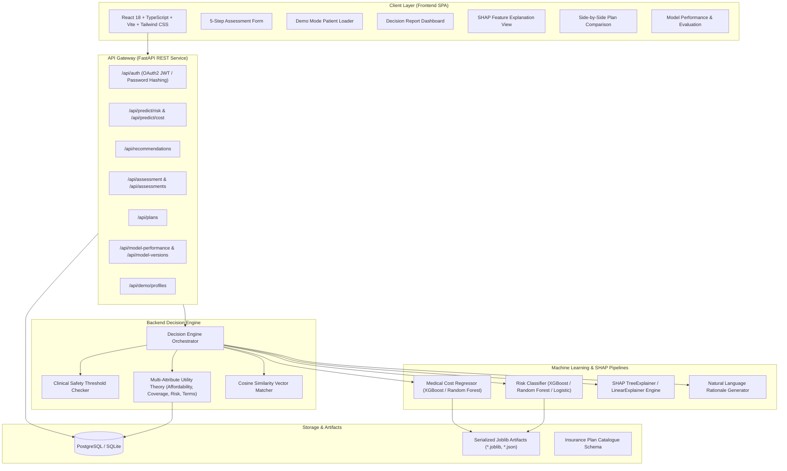

# System Architecture Documentation

## Intelligent Healthcare & Health Insurance Decision Platform

> **Scope Disclaimer**: This platform is designed solely as a **decision-support platform** connecting statistical health risk, expected medical costs, and structured insurance plans. It does **not** perform medical diagnoses, clinical disease prescriptions, or guarantee underwriting policy issuance.

---

### 1. High-Level Architectural Topology

---

### 2. End-to-End Processing Workflow

1. **User Input Collection**:
   The user supplies demographic (age, gender, BMI), clinical vitals (blood pressure, fasting glucose, serum cholesterol), lifestyle attributes (smoking, physical exercise), and insurance constraints (annual budget, family dependents, coverage preference).
2. **Clinical Safety Guardrails**:
   If clinical values enter hypertensive crisis ($\ge 180/120\text{ mmHg}$) or marked hyperglycemia ($\ge 250\text{ mg/dL}$), safety alerts are generated to strongly advise qualified medical attention.
3. **Module 1 — Health Risk Prediction**:
   - Features are transformed through `StandardScaler` (fitted exclusively on the training split).
   - The winning classifier (Logistic Regression / XGBoost / Random Forest) predicts probabilities for Low, Medium, and High risk.
   - An overall composite risk score ($0$–$100\%$) is formulated.
   - The SHAP Engine computes additive feature attributions ($\phi_i$) and maps them to human-readable plain language explanations.
4. **Module 2 — Medical Cost Estimation**:
   - Categorical and numeric features pass through a `ColumnTransformer` (One-Hot Encoding + Standard Scaling).
   - The winning regressor predicts expected annual out-of-pocket medical expenditures, monthly equivalents, and cost driver attributions.
5. **Module 3 — Structured Insurance Plan Recommendation**:
   - The engine queries active insurance products from the database catalogue.
   - Ineligible policies (e.g., age limits) are filtered out.
   - Surviving plans are evaluated through a 4-attribute weighted scoring model:
     $$\text{Score} = w_1 \cdot \text{Affordability} + w_2 \cdot \text{Coverage Fit} + w_3 \cdot \text{Risk Match} + w_4 \cdot \text{Terms Fit}$$
   - Cosine similarity evaluates multi-dimensional profile-to-plan feature compatibility.
   - The top 3 ranked plans are populated with tailored reasons and important exclusions.
6. **Persistence & Presentation**:
   - If authenticated, the assessment report is stored in relational tables for longitudinal tracking.
   - The interactive React dashboard displays visual risk gauges, cost projections, SHAP charts, and plan cards.

---

### 3. Database Schema Overview

- **`users`**: Authentication credentials, roles (`user`, `admin`), timestamps.
- **`assessments`**: Root assessment container linking user to evaluations.
- **`health_profiles`**: Clinical vitals, lifestyle habits, and financial preferences.
- **`risk_predictions`**: Risk level, probability, SHAP attributions, clinical alerts.
- **`cost_predictions`**: Annual cost, monthly equivalent, confidence interval, cost drivers.
- **`insurance_plans`**: Structured catalogue of insurance policies, premiums, sum insured, exclusions, waiting periods, room rent terms.
- **`recommendations`**: Scored and ranked plan associations with personalized rationales.
- **`model_versions`**: Tracking serialized model tags, training dates, and provenance.
